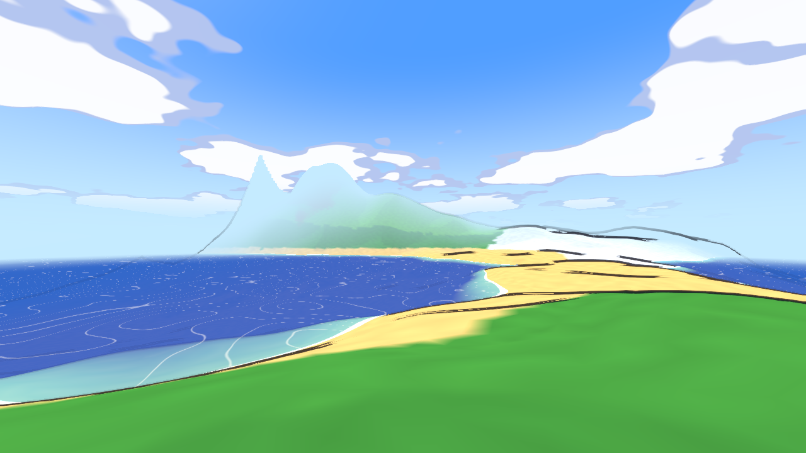
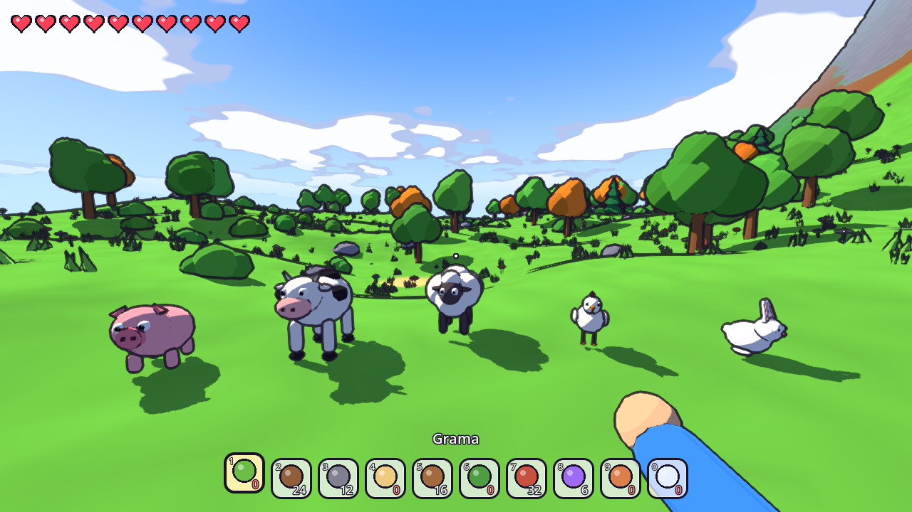
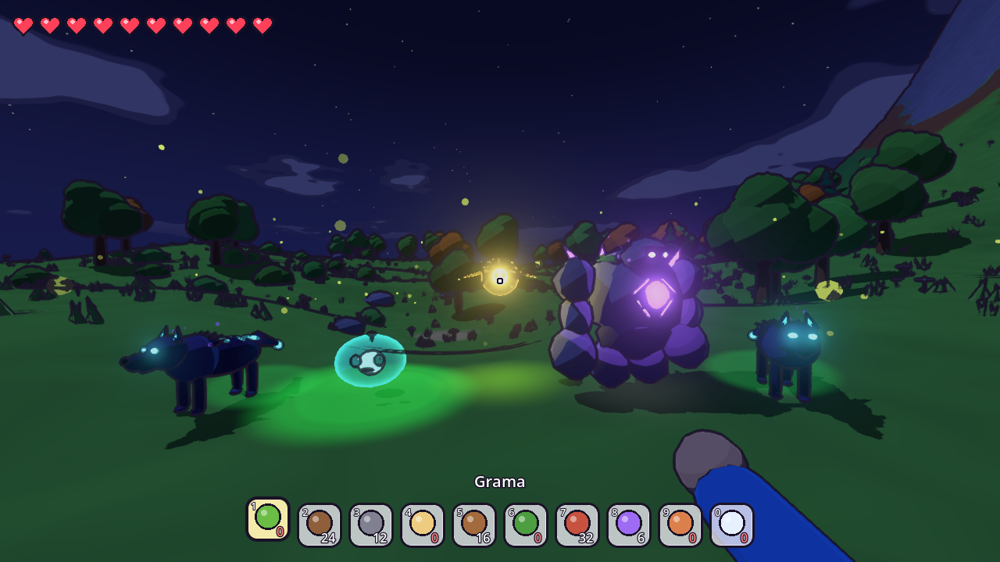

# Terra Redonda

Um jogo estilo Minecraft feito na **Godot 4.7**, com mapa infinito, mas **sem quadrados**:
o terreno é suave e arredondado, o visual é **cartoon** (sombras em faixas e contorno
de desenho animado) e, **à noite, aparecem criaturas muito mais legais**. Primeira pessoa.



## Como jogar no Linux

### Jeito 1: executável pronto (mais fácil)

Baixe o pacote `TerraRedonda-linux-x86_64.tar.gz` e rode:

```bash
tar -xzf TerraRedonda-linux-x86_64.tar.gz
cd TerraRedonda
./TerraRedonda.x86_64
```

Se a placa de vídeo for antiga (sem Vulkan): `./TerraRedonda.x86_64 --rendering-driver opengl3`

### Jeito 2: direto do código-fonte

```bash
git clone <este repositório>
cd teste
./jogar.sh
```

O `jogar.sh` baixa a Godot 4.7.2 sozinho na primeira vez (~75 MB, sem precisar de sudo).
Outras opções:

- `./jogar.sh --editor`: abre o projeto no editor da Godot para mexer no jogo.
- `./jogar.sh --opengl`: modo compatível para PCs antigos.

Se você já tem a Godot 4.7 instalada, também pode abri-la e importar o arquivo `project.godot`.

### Gerar o executável você mesmo

Com a Godot 4.7.2 e os *export templates* do Linux instalados:

```bash
tools/exportar_linux.sh   # cria build/TerraRedonda-linux-x86_64.tar.gz
```

## Controles

| Tecla | Ação |
|---|---|
| WASD / setas | andar |
| Mouse | olhar |
| Espaço | pular / nadar para cima |
| Shift | correr |
| Clique esquerdo | cavar, cortar árvore, bater nos bichos |
| Clique direito | construir com o material escolhido |
| 1 a 0 / roda do mouse | escolher material |
| G | modo criativo (material infinito) |
| F11 | tela cheia |
| Esc | pausa (configurações, salvar e sair) |

## O que tem no jogo

- **Mundo infinito** gerado por chunks em várias threads. O terreno usa *Surface Nets*,
  então tudo fica liso e arredondado, inclusive o que você cava ou constrói.
- **8 biomas**: planície, floresta, bosque mágico (cogumelos gigantes), deserto, neve,
  montanha, praia e oceano.
- **Visual cartoon**: iluminação em faixas, contorno preto, céu com nuvens desenhadas,
  sol, lua crescente, estrelas e água com espuma na beira.
- **Cavar e construir** em esferas suaves, com 10 materiais. Dá também para cortar
  árvores e quebrar pedras.
- **Dia**: porcos, vacas, ovelhas, galinhas e coelhos, que passeiam, olham para você e
  fogem quando apanham.
- **Noite**, com criaturas brilhantes e espertas:
  - **Lobo Sombrio**: anda em matilha, rodeia você e dá o bote.
  - **Gosma Lunar**: gelatina brilhante que pula e se divide em duas.
  - **Espírito Vaga-lume**: voa em círculos e dá rasantes.
  - **Golem de Cristal**: gigante raro que soca o chão.
  - E ainda vaga-lumes, além de cogumelos e cristais que brilham no escuro.
- **Salvamento automático** a cada 2 minutos e ao sair. Menus em estilo cartoon,
  com semente do mundo e configurações (distância de visão, sensibilidade, tela cheia, contorno).




## Estrutura

```
scenes/main.tscn            cena principal (monta tudo por código)
scripts/main.gd             ambiente, menus, salvar, modo foto
scripts/world/              gerador do mundo, chunks, malha suave, árvores
scripts/player/             jogador e inventário
scripts/mobs/               bichos do dia e criaturas da noite
scripts/ui/                 HUD e menus
shaders/                    terreno, céu, água, contorno, bichos
tools/foto.sh               tira fotos do jogo sem janela (Xvfb)
tools/autoteste.sh          joga sozinho por N segundos e mostra erros
```
